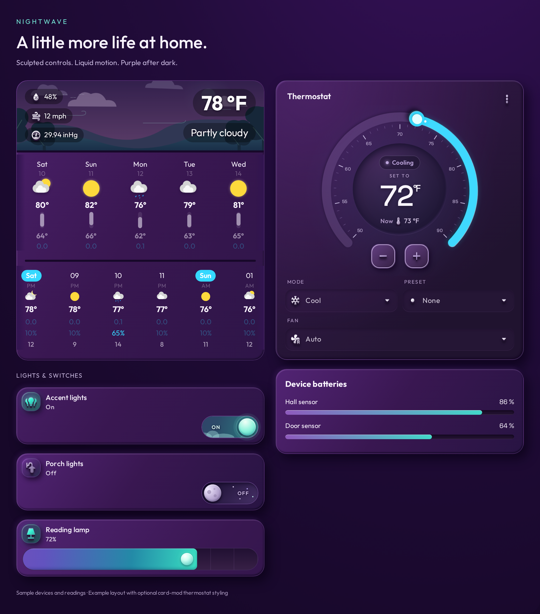
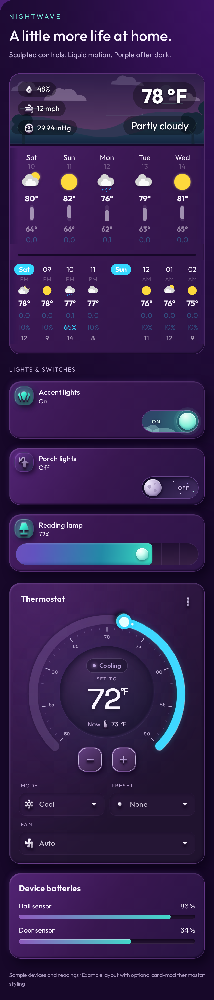
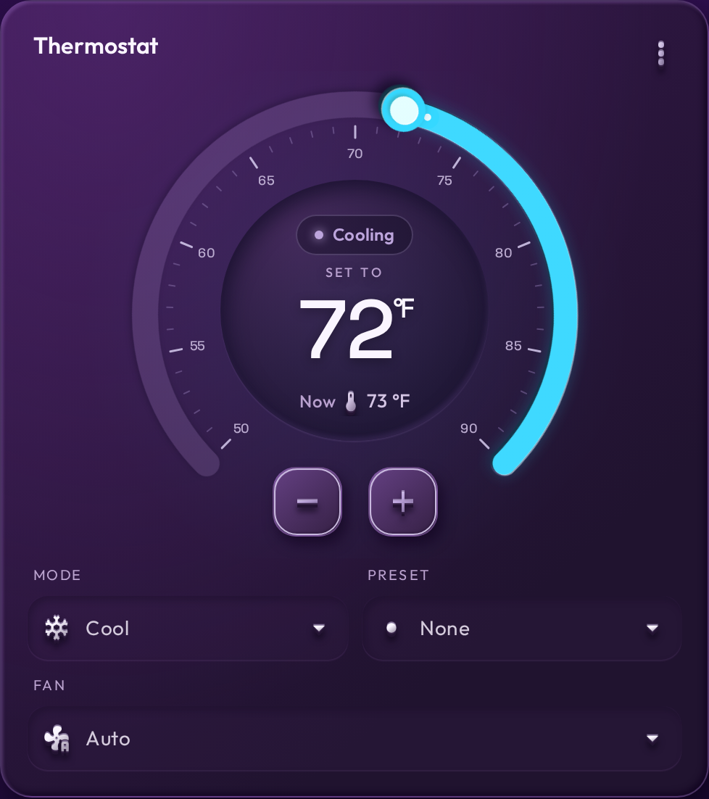
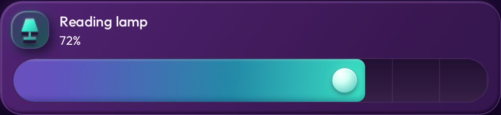
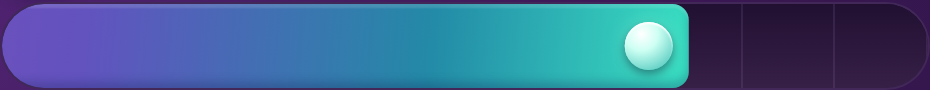
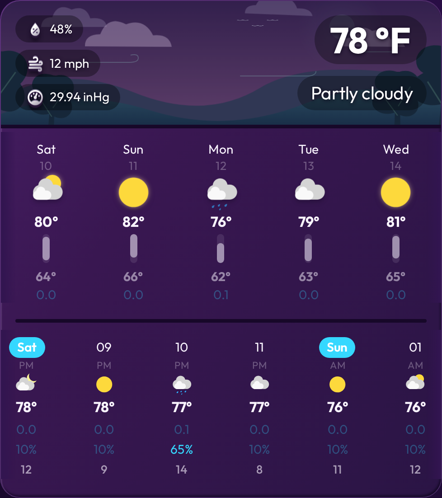
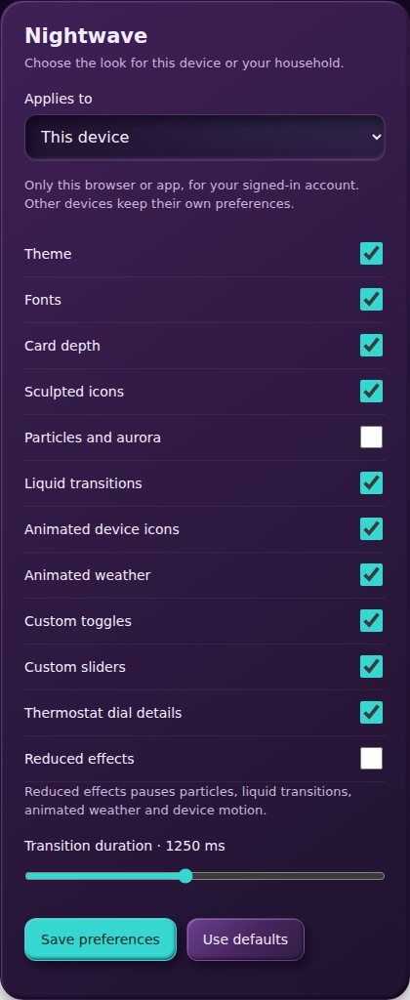

# Nightwave UI

Purple and cyan motion, sculpted icons, an organic liquid view reveal, and animated weather for Home Assistant. Initial release **0.3.1**. One repository contains the theme, UI, optional settings integration, and device settings card. It does not contain a household dashboard.

[Releases and downloads](https://github.com/nextcode4u/Nightwave-UI---Home-Assistant/releases) · [Report an issue](https://github.com/nextcode4u/Nightwave-UI---Home-Assistant/issues)

## Preview

Screenshots of rendered Home Assistant components with **sample devices and readings**. This illustrates a possible layout; the package styles your dashboard rather than installing this layout automatically. The sculpted thermostat uses the included optional card-mod example. The full weather example uses weather-forecast-extended-card with sample daily/hourly forecasts and the bundled animated landscape.

### Desktop



### Mobile



### Thermostat detail



Use [`examples/lamp.yaml`](examples/lamp.yaml) for the lamp icon, brightness control and default depth styling. Icon shapes come from each card’s `icon` setting; the package shades them rather than replacing all icons.

### Lamp card depth



### Brightness slider



The bundle applies this styling automatically to native dashboard sliders. The droplet value label appears during interaction.

### Complete weather card



Use [`examples/weather.yaml`](examples/weather.yaml) with your own forecast-capable weather entity to reproduce the full weather card. These still images show the styling. Clouds, wind, icons and transitions animate when motion is enabled.

See the [live UI comparison](docs/visual-parity.md) for what matches and what is deliberately excluded.

## Features

- Device-specific preferences, administrator-managed household defaults, and optional automation entities.
- Persistent particle/aurora background; hidden-tab and reduced-motion handling.
- Organic liquid navigation reveal, configurable duration (default 1 second).
- Shaded existing icons, state-aware light/fan/HVAC/media animation.
- Weather landscape with wind-driven trees, clouds, rain/snow, birds and night sky.
- Thermostat tick marks; optional large day/night toggle styling.
- `nightwave-glance`, `nightwave-meters`, `nightwave-neon-link`, and collapsed `nightwave-details` cards.
- Raised standard button icons, compact entity switches, and opt-in custom-card surface styles.
- Locally bundled Outfit and Space Grotesk fonts, with their licenses.

## Install: one package

The full package is now a **HACS Integration**, with the UI bundle inside `custom_components/nightwave/www/`. Setup loads that bundle automatically; no resource URL editing is needed. Add this repository to HACS as a custom **Integration**. This is an experimental community package; it is not yet listed in the default HACS catalog. Backend setup has been tested on Home Assistant 2026.10.1, with desktop/mobile browser checks. A full installation/update cycle through HACS remains to be verified.

### Full installation

1. Open **HACS → ⋮ → Custom repositories**, add `https://github.com/nextcode4u/Nightwave-UI---Home-Assistant`, choose **Integration**, then download Nightwave. For a local installation, copy `custom_components/nightwave` into `/config/custom_components/nightwave`.
2. Restart Home Assistant.
3. Open **Settings → Devices & services → Add integration → Nightwave**. Enter dashboard URL prefixes such as `lovelace` or `dashboard-tablet` (comma separated for multiple dashboards).
4. Refresh the browser. Add a **Nightwave settings** card from the dashboard card picker, or use:

```yaml
type: custom:nightwave-settings
```

### Settings and scope



- **This device:** overrides for the signed-in account in this browser or Companion App. Other devices and other users keep their own preferences. Clearing browser/app data removes these overrides. Different URLs/origins have separate browser storage.
- **Household defaults:** administrators can edit shared settings through the card or the integration's Configure/options screen. The backend enforces administrator access to the settings update endpoint.
- **Use defaults:** clears this device's overrides. Only settings you change are saved locally, so untouched options keep inheriting household changes.
- **Reduced effects:** disables particles, liquid transitions, animated weather and device icon motion while retaining the theme and sculpted controls. This is a lighter preset, not a guarantee of zero animation from all third-party cards. System reduced-motion remains respected by supported effects.
- **Save, then Refresh now:** changes are persisted immediately and applied when that browser reloads. Other open dashboards must also refresh. Automation changes update defaults for the next load; this release does not hot-reconfigure running animations.

Preference priority is **built-in defaults → household → legacy resource URL options → device overrides**. Prefer the integration's automatic resource (no legacy options) for straightforward inheritance. If the integration cannot be reached at startup, the settings card stays available and effects wait for a successful refresh; credentials are never stored by Nightwave.

### Optional automation entities

The integration registers 12 switches (theme, fonts, card depth, icons, particles, transitions, device motion, weather, toggles, sliders, dial details, reduced effects) plus a transition-duration number (250–2500 ms). All are **disabled by default**. Enable only what you need in the integration's entity list. They modify the same household defaults as the settings card, not actual light/thermostat entities.

Once enabled, these entities use normal Home Assistant entity/service permissions, including automation access. The settings card's admin-only household restriction does not make enabled entities admin-only. Leave them disabled if you want household edits confined to the admin settings interface.

### Dependencies

| Feature | Dependency |
| --- | --- |
| Full integration | Home Assistant; tested on 2026.10.1 |
| HACS installation | HACS; optional for manual installation |
| Swipe gestures | Optional hass-swipe-navigation; tab/button transitions need no swipe dependency |
| Animated weather landscape | Optional weather-forecast-extended-card with a weather entity |
| Detailed thermostat example | Optional card-mod; supported Mode, Preset, Fan features configured in the example |
| Navigation button enhancements | Optional button-card |

The Python integration has no third-party requirements. Fonts and their licenses are bundled locally. Dependencies from HACS are not installed automatically. The package does not create household views, device mappings, weather cards, swipe configuration, or automations.

### Frontend-only alternative

You can still copy `dist/nightwave-ui.js` to `/config/www/nightwave-ui/` and add `/local/nightwave-ui/nightwave-ui.js?dashboard=lovelace` as a JavaScript Module dashboard resource. This provides the theme, effects and device preferences without a Python integration. Household defaults and automation entities require the integration. Do not combine this method with the automatic integration loader.

The dashboard-scoped theme restores previous styles when leaving the selected dashboard. Your profile theme controls the sidebar and global dialogs.

### Optional full-interface profile theme

The same repository includes `themes/nightwave.yaml` for users who want matching global dialogs and other panels. Copy it to `/config/themes/nightwave/nightwave.yaml`, enable theme loading if needed, reload themes using `frontend.reload_themes`, and select Nightwave in your profile:

```yaml
frontend:
  themes: !include_dir_merge_named themes
```

Merge into an existing frontend section; do not duplicate it. A first-time configuration change may require a validated restart. The integration installation does not copy this optional YAML into the themes directory. This extra step is unnecessary for the automatic dashboard theme.

Remove old standalone Nightwave resource entries before loading this bundle and reload clients. The bundle does not send device commands or collect analytics.

## Configuration

Set options in the resource URL. Reload the browser after changing options.

| Parameter | Default | Meaning |
| --- | --- | --- |
| `dashboard` | `lovelace` | Dashboard URL prefix without leading slash; comma-separated prefixes supported. |
| `duration` | `1000` | Liquid reveal duration in milliseconds, clamped to 250–2500. |
| `theme` | `true` | Automatically theme the selected dashboard. |
| `particles` | `true` | Background particles and aurora. |
| `transitions` | `true` | Liquid reveal and weather condition particle reveal. |
| `motion` | `true` | State-aware icons and ambient card animation. |
| `icons` | `true` | Sculpted shading of existing SVG icons. |
| `weather` | `true` | Landscape in weather-forecast-extended-card. |
| `weather-touch` | `true` | Forecast scroll gesture adjustment. |
| `dial` | `true` | Tick marks on the native thermostat dial. |
| `fonts` | `true` | Locally bundled font declarations. |
| `depth` | `true` | Raised tile-icon backgrounds, inset highlights and tile entrance effects. |
| `sliders` | `true` | Sculpted gradient tracks, raised handles and droplet value labels on native sliders. |
| `controls` | `true` | Large sky toggles; disable if your tile layout is too compact. |
| `cards`, `links` | `true` | Register the optional Nightwave cards. |
| `fan_entities` | empty | Comma-separated entity IDs for switches that operate fans. Native `fan` entities work automatically. |

For a less powerful phone, try `&particles=false&motion=false`. To disable the liquid reveal entirely, use `&transitions=false`. Operating-system reduced motion disables the reveal and other movement.

## Cards and examples

Replace all example entity IDs with your own. Only add a card if you have its referenced entity.

```yaml
type: custom:nightwave-glance
weather: weather.example
batteries:
  - sensor.example_battery
# Optional: a binary sensor whose ON state means a power warning.
# power_entity: binary_sensor.example_power_warning
```

```yaml
type: custom:nightwave-meters
title: Device batteries
entities:
  - entity: sensor.example_battery
    name: Hall sensor
```

```yaml
type: custom:nightwave-neon-link
name: Living room
icon: mdi:sofa
path: /lovelace/living-room
room: true
```

`examples/thermostat.yaml` includes Mode, Preset and Fan dropdowns plus the original sculpted thermostat styling using **card-mod**, which must be installed separately. Remove Preset or Fan if your thermostat does not expose those modes. Brightness sliders are styled automatically by the bundle. `examples/brightness.yaml` is an optional card-mod alternative for users who disable `sliders`. `examples/toggle.yaml` shows a native toggle tile; sky styling is enabled by default. The package does not require card-mod for its basic theme, particles or transitions.

Weather landscape enhancement requires **weather-forecast-extended-card**, installed separately through HACS. Other optional integrations with **button-card** and native thermostat/tile controls activate only when those elements are present. Third-party cards are not bundled.

For swipe gestures, install **hass-swipe-navigation** separately and disable its own animation to avoid two effects:

```yaml
swipe_nav:
  enable: true
  animate: none
  skip_subviews: true
  enable_on_subviews: false
```

Nightwave animates view changes; it does not implement swipe recognition. Preserve the swipe integration's exclusions for sliders and remote touchpads.

## Compatibility and limits

Requires a modern browser with Web Animations, CSS path clipping, constructed stylesheets and Shadow DOM. Native HA and optional card internals are used; Home Assistant or card updates can change those internals. Test a separate dashboard first. The visual layer is experimental and is not an official Home Assistant integration.

The liquid effect reveals the new live view over the existing background. It does not capture the outgoing view. Fonts are declared globally but the visual hooks are scoped to the configured dashboard prefixes. Custom cards are styled wherever explicitly placed. Reduced motion is respected. Smoothness still depends on the client device and dashboard complexity.

## Build and validate

Node.js 20 or newer; no npm dependencies:

```sh
npm run build
npm run check
```

Browser fixture tests use Python with `playwright` installed and Chromium available:

```sh
python -m playwright install chromium
python tests/test_browser.py
python tests/test_settings_browser.py
python tests/test_settings.py
python tests/test_parity_browser.py
```

Canonical theme values live in `assets/theme.json`. The build embeds them and generates `themes/nightwave.yaml` (JSON syntax is valid YAML). It writes identical frontend bundles to `dist/nightwave-ui.js` (standalone) and `custom_components/nightwave/www/nightwave-ui.js` (integration). Commit both outputs whenever source changes. Complete the [release checklist](docs/release.md) before publishing/tagging `v0.3.1`.

## Uninstall

Remove the Nightwave integration from Devices & services, remove its custom cards, then refresh all clients. Remove the package through HACS or delete its custom component folder and restart. For the standalone method, remove the dashboard resource and its files instead. If you installed the optional profile theme, select another theme before removing its YAML. Browser hooks and the scoped theme clear on full reload. Device overrides stay in browser storage until you choose “Use defaults” or clear site data.

## Credits

Original Nightwave code under MIT. See [THIRD_PARTY.md](THIRD_PARTY.md) for font licenses and visual references. No CodeMyUI mask images or third-party card source are included.

HACS documentation: [Integration packaging](https://hacs.dev/docs/publish/integration/), [custom repositories](https://hacs.xyz/docs/faq/custom_repositories/).
